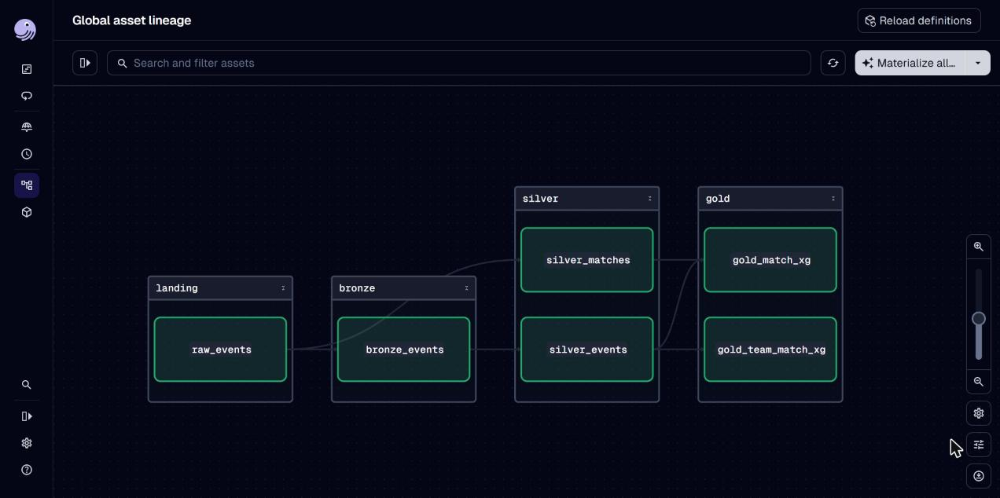

# rh-lakehouse

A PySpark and Databricks version of the historical match-data layer behind
[RH Sports Analysis](https://rhsportsanalysis.com). The production pipeline
([rh-analytics-pipeline](https://github.com/HeiserTGx/rh-analytics-pipeline)) runs on
Postgres, dbt and Dagster, which is the right size for the data. This repo rebuilds the
same layer on Spark to work through how the lakehouse approach differs.

Built on Databricks Free Edition (serverless) and orchestrated from Dagster.



## The pipeline

```
raw_events ──► bronze_events ──► silver_events ──┬──► gold_team_match_xg
(JSON files)   (raw rows)        (typed, MERGE)  └──► gold_match_xg
     │                                                      ▲
     └──────────────► silver_matches ───────────────────────┘
```

The first three are partitioned by competition season. Loading a season lands its
files, swaps it into bronze and merges it into silver. Nothing already loaded is parsed
again.

| Piece | What it is |
|---|---|
| [`pipeline/steps.py`](pipeline/steps.py) | The Spark code: one function per step, lifted from notebook 02. Each returns its counts for the orchestrator to record. |
| [`pipeline/run_step.py`](pipeline/run_step.py) | The notebook the orchestrator calls. It runs the step named in its `step` parameter and hands the counts back as the run's output. |
| [`rh_lakehouse/assets/events.py`](rh_lakehouse/assets/events.py) | Six Dagster assets, one per table plus the landed files. Each one is a single step run on Databricks. |
| [`rh_lakehouse/assets/checks.py`](rh_lakehouse/assets/checks.py) | Two data-quality checks, run as SQL on the SQL warehouse: no event is in silver twice, and goals counted from events equal the official score in every match. |
| [`rh_lakehouse/resources.py`](rh_lakehouse/resources.py) | The Databricks resource. Submits a step as a one-time serverless run through the Jobs API, waits for it and reads the counts back. Credentials come from the environment. |

## Design notes

- **Dagster coordinates, Databricks computes.** Dagster runs no Spark and holds no data.
  Each asset submits one serverless run and records what the step reports (rows loaded,
  rows the MERGE inserted and updated) with a link to the run in Databricks.
- **Steps run from Git.** A run takes its code from this repo at a named branch, so what
  ran is a commit, not whatever was last saved in the workspace.
- **Partitioned by season, as in rh-analytics-pipeline.** A new season is one partition
  and a backfill is several. Two seasons loaded at the same moment, as separate runs
  into the same tables, gave the same row counts as loading them one after the other.
- **Safe to run twice.** Bronze replaces the season it is loading and silver merges on
  the event id, skipping rows whose hash has not changed. A repeat load inserts nothing
  and updates nothing.

## Notebooks

The notebooks are where each step was worked out, with the output shown as it goes.

| Notebook | What it does |
|---|---|
| [`01_match_xg_team_form`](notebooks/01_match_xg_team_form.py) | Reads the raw match CSV with an explicit schema, reshapes it to one row per team per match, builds a season table, and computes rolling five-match xG form with a window function. Ends with the execution plan. |
| [`02_events_bronze_silver_gold`](notebooks/02_events_bronze_silver_gold.py) | Starts a level below notebook 01, from the events inside each match. Lands raw JSON files in a volume, then builds bronze (one raw row per event), silver (typed columns from an explicit schema, partitioned by competition and season) and gold (xG per team per match, and per match with home and away). New seasons are added incrementally: a `replaceWhere` load into bronze, then a `MERGE` into silver that names the partition it is loading and skips unchanged rows by hash. Events join to the match list as a broadcast join, with the shuffle plan shown beside it for comparison. |

## What it runs on

| | |
|---|---|
| Matches | 1,517 |
| Events in silver | 5,321,459 |
| Repeat load of all four seasons through Dagster | 0 rows inserted, 0 updated |
| Matches where goals counted from events differ from the official score | 0 |

## The join, before and after

Gold needs to know which side was at home, which lives in the match list: 1,517 rows
against 5.3 million events. Both plans below are for that same join, from `EXPLAIN` on
the SQL warehouse, cut down to the join and what feeds it (column ids, scan details and
some intermediate operators removed).

**Before: a shuffle join.** Both tables are shuffled by the join key and sorted so that
matching rows meet. Every one of the 5.3 million events is moved to do it.

```
SortMergeJoin [match_id, competition_id, season_id], Inner
:- PhotonSort [match_id, competition_id, season_id]
:  +- PhotonShuffleExchangeSink hashpartitioning(competition_id, season_id, match_id, 16)
:     +- PhotonScan parquet workspace.rh_lakehouse.silver_events
+- PhotonSort [match_id, competition_id, season_id]
   +- PhotonShuffleExchangeSink hashpartitioning(competition_id, season_id, match_id, 16)
      +- PhotonScan parquet workspace.rh_lakehouse.silver_matches
```

**After: a broadcast join.** The match list is copied to every worker and the events
are joined where they already are. There is no shuffle and no sort on the events side.

```
PhotonBroadcastHashJoin [competition_id, season_id, match_id], Inner, BuildRight
:- PhotonScan parquet workspace.rh_lakehouse.silver_events
+- PhotonShuffleMapStage EXECUTOR_BROADCAST
   +- PhotonShuffleExchangeSink SinglePartition
      +- PhotonScan parquet workspace.rh_lakehouse.silver_matches
```

The shuffle plan also falls out of Photon, Databricks' vectorised engine, at the join:
the warehouse reports the sort-merge join as an unsupported node, and the broadcast
plan as fully supported.

## Running it

```powershell
# .env in the repo root (never committed):
#   DATABRICKS_HOST           workspace URL
#   DATABRICKS_TOKEN          personal access token
#   DATABRICKS_WAREHOUSE_ID   the SQL warehouse the checks run on
#   LAKEHOUSE_SCHEMA          where the tables are written, e.g. workspace.rh_lakehouse
#   LAKEHOUSE_GIT_BRANCH      the branch of this repo the steps run from, e.g. main

.\dev.ps1   # sets a persistent DAGSTER_HOME, starts dagster dev on localhost:3000
            # (dagster dev reads the .env itself)
```

Python 3.13. `pip install -e .`

The workspace needs one thing created by hand: the volume `workspace.rh_lakehouse.raw`,
where the source files land. The tables are created on the first run. Materialise
`raw_events` and everything downstream for a season partition, or backfill all four.

## Data

**Match xG (notebook 01).** One row per finished match in Europe's top five leagues from
2014/15 onwards (about 21.6k matches): teams, goals and expected goals, sourced from
Understat by the ingestion asset in rh-analytics-pipeline. The file is not committed
here. To reproduce, run that asset's backfill, export `understat_match_xg` to CSV and
upload it to the `workspace.rh_lakehouse.raw` volume.

**Match events (notebook 02 and the pipeline).** Public match event data for the 2015/16
season of four leagues (Premier League, La Liga, Serie A, Ligue 1): one JSON file per
match, about 3,500 events each. The files are downloaded into the same volume by the
pipeline itself, so it runs with nothing to upload. No data is committed here.
